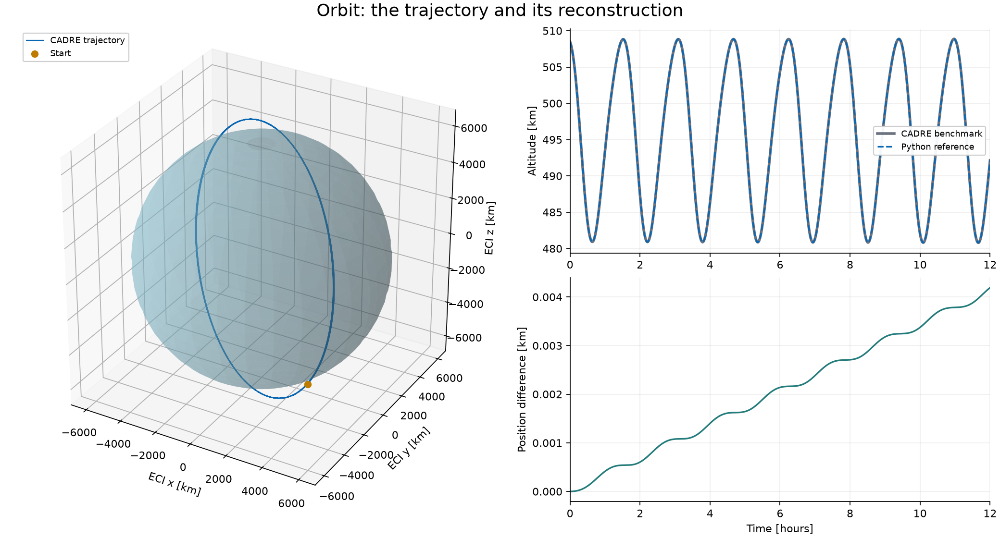

# CADRE-AMIGO

I'm reproducing the OpenMDAO CADRE CubeSat model in Python and AMIGO. I started
with the individual subsystems, checked them against the original CADRE code,
and then connected them into a single-case optimization.

The coupled model now optimizes communication power, solar currents, and initial
battery state of charge over a 12-hour window. The full-size version with free
roll and surface allocation is still unfinished.

## Running the code

The scripts need a local CADRE checkout and a Python environment with AMIGO,
NumPy, SciPy, and Matplotlib. Set `CADRE_ROOT` to the checkout containing
`src/CADRE`. If it is at `../CADRE`, the default path already works.

Run commands from this repository's root. I use the Pixi environment from my
AMIGO checkout:

```sh
# Optimize communication power, solar currents, and initial SOC.
pixi run --manifest-path ~/git/amigo/pixi.toml python -m integrated.cadre_optimize_pcomm

# Use the restored design-physics formulation with fixed roll and allocation.
pixi run --manifest-path ~/git/amigo/pixi.toml python -m integrated.cadre_optimize_pcomm --design-physics

# Plot a saved result without solving it again.
pixi run --manifest-path ~/git/amigo/pixi.toml python -m integrated.plot_pcomm_results

# Generate the subsystem figures.
pixi run --manifest-path ~/git/amigo/pixi.toml python -m visualizations
```

Change the manifest path if AMIGO is installed somewhere else. Compiling a model
also requires CMake and a C++ compiler on `PATH`.

## Validated integrated result

The full 12-hour fixed-design case uses 1,500 time nodes and 3,901 design variables.
It optimizes communication power, 12 solar-current profiles, and initial SOC.
Roll and surface allocation are fixed.

| Measurement | Result |
| --- | --- |
| Downloaded data | 5,264.536 CADRE units |
| Feasible comparison baseline | 5,058.245 CADRE units |
| Improvement | 4.0783% |
| Solver iterations | 58 |
| Solver time | 776.73 seconds |
| Final KKT error | 1.00e-9 |

The run satisfies battery-current and SOC bounds, returns to its starting SOC,
and passes an independent trajectory replay. Solver time excludes preparation,
compilation, and replay. This is one case with fixed geometry, so it should not
be treated as a runtime comparison with the original six-case CADRE study.

See the [result and figures](integrated/docs/meeting_result.md),
[saved summary](integrated/results/pcomm_design_reference/summary.json), and
[integrated model README](integrated/README.md).

## Plots

The [subsystem figure gallery](visualizations/README.md) covers orbit, attitude,
sunlight, panel exposure, temperature, power, battery SOC, reaction wheels,
communication, and spline controls. It uses the original CADRE benchmark and
the Python reference functions. Existing interactive plots are still in the
subsystem scripts.



Figures are currently stored together in `visualizations/figures/`. The gallery
explains the inputs and comparisons in each one. To generate a smaller selection:

```sh
pixi run --manifest-path ~/git/amigo/pixi.toml python -m visualizations \
  --problem orbit thermal battery --output /tmp/cadre-figures
```

## Code layout

| Folder | Contents |
| --- | --- |
| `orbit/` | Orbital dynamics, RK4 reference, AMIGO collocation, and grid convergence |
| `attitude/` | Orientation, angular rates, acceleration, and torque |
| `sun/` | Sun direction and eclipse calculations |
| `solar/` | Panel exposure and the recreated solar MBI lookup |
| `thermal/` | Four fin temperatures and one body temperature |
| `power/` | Solar voltage, solar power, and net battery power |
| `battery/` | Voltage, current, SOC propagation, and constraint checks |
| `reaction_wheel/` | Wheel dynamics and electrical consumption |
| `communication/` | Antenna gain, bitrate, and accumulated downloaded data |
| `parameters/` | B-spline controls and time-dependent inputs |
| `integrated/` | Coupled model, optimization, solver adapters, checks, and saved results |
| `visualizations/` | Figure-generation code, explanations, and saved plots |

Inside `integrated/`, the code is grouped into `model/`, `reference/`,
`optimization/`, `solvers/`, `reporting/`, `benchmarks/`, and `validation/`.
The main optimization and plotting commands remain at the top level.

## How I check the models

For each subsystem, I compare a Python reference with the original CADRE output,
then compare the AMIGO model with that reference. I keep RK4 and trapezoidal
comparisons separate because differences between integration schemes are not
the same as errors in the equations.

The solar and voltage lookups use recreated MBI splines. Their remaining
reference differences are recorded in the validation scripts and
[figure measurements](visualizations/figures/measurements.json).

The integrated solver, evaluator, checkpoint, and derivative checks are in
`integrated/validation/`. Their saved reports are in
`integrated/results/validation/`. Commands and tolerances are listed in the
[integrated README](integrated/README.md#validation).

## Remaining work

A shorter 600-node case with free roll and surface allocation has passed
validation. The full 1,500-node, 4,285-variable version still needs to converge
and pass independent replay. The next step is to finish that case before
expanding toward the original multi-case problem.

The [roll/allocation status note](integrated/docs/roll_allocation_status.md)
records the current solver setup and restart command.
