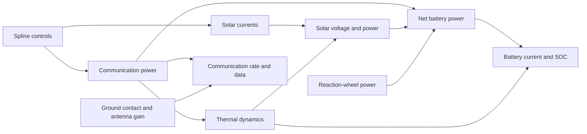
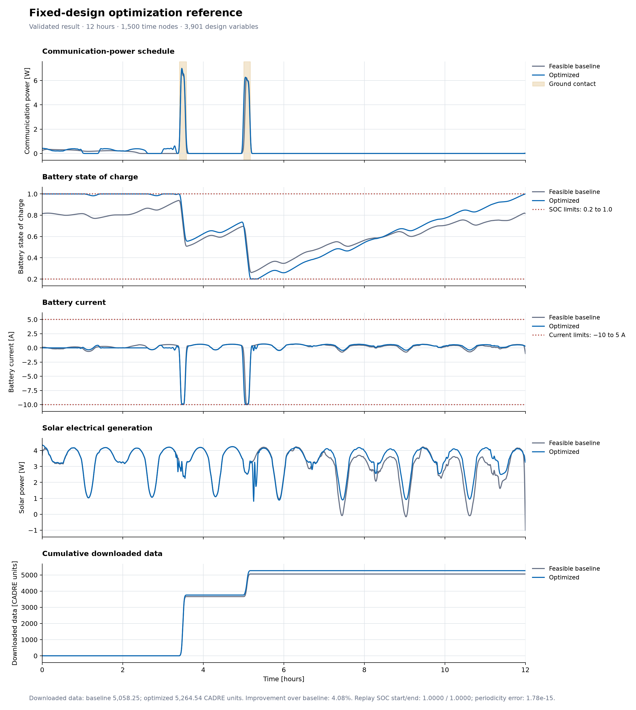
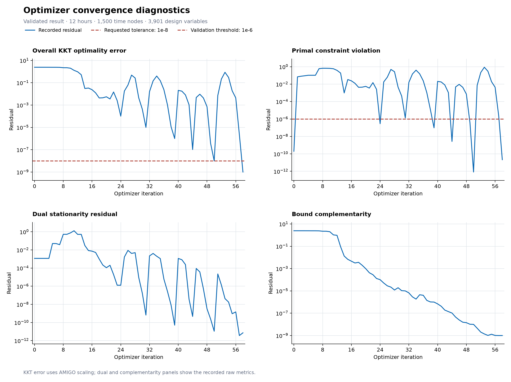

# Integrated CADRE optimization

This is the coupled model for one CADRE case. It connects thermal dynamics,
reaction wheels, solar power, the battery, and communication. Run it from the
repository root using the AMIGO environment:

```sh
pixi run --manifest-path ~/git/amigo/pixi.toml python -m integrated.cadre_optimize_pcomm
pixi run --manifest-path ~/git/amigo/pixi.toml python -m integrated.plot_pcomm_results
```

Set `CADRE_ROOT` if the external CADRE checkout is not at `../CADRE`. Compilation
requires the AMIGO environment's CMake and compiler on `PATH`.

## Directory layout

```text
integrated/
├── cadre_optimize_pcomm.py     Optimization command
├── cadre_benchmark_amigo.py    Fixed-input benchmark command
├── cadre_single_case.py        Earlier benchmark command name
├── plot_pcomm_results.py       Plotting command
├── model/                     AMIGO components, links, bounds, and initialization
├── reference/                 Input data, trajectory replay, and feasibility repair
├── optimization/              Options, solver selection, and checkpoints
├── solvers/                   Sparse LU, native LDL, and evaluator adapters
├── reporting/                 Terminal reports, result files, and plotting
├── benchmarks/                Coupled fixed-input benchmark implementation
├── validation/                Numerical checks and lightweight AMIGO adapters
├── results/                   Saved optimization cases and validation reports
│   └── validation/            Numerical validation measurements
├── docs/                      Results, formulation details, and extension status
└── archive/                   Original SOC-only formulation
```

The top-level scripts are the command entry points. Start with `model/builder.py` for the coupled model,
`reference/case.py` for its inputs, or `optimization/driver.py` for the solver.
`power/voltage_spline.py` contains the shared temperature/current voltage model.
Equation variables such as `SOC`, `P_comm`, `CP_Isetpt`, and `cellInstd` retain
the CADRE names used in the subsystem implementations.

## Coupled model



AMIGO solves these equations together at the time nodes. Battery limits and
periodic SOC constrain the communication and solar-current schedules.
With design physics enabled, roll also changes solar exposure, antenna gain,
and reaction-wheel power; surface allocation changes the thermal dynamics.

## Formulation

The default is a complete 12-hour case with 1,500 nodes and 300 cubic B-spline
controls per profile: communication power, 12 solar-current profiles, and initial
SOC give **3,901 design variables**. Roll and cell/radiator allocation are prescribed.
Fin angle, antenna mounting, orbit, and the other five seasonal cases are fixed or
absent. Trajectory constraints use trapezoidal integration.

Bounds are 0–25 W for communication controls, 0–0.4 A for solar-current controls,
0.2–1.0 for SOC, and −10–5 A for battery current. Final SOC equals optimized initial
SOC. Coupled voltage uses the original CADRE table; temperatures stay in its
50–400 K domain. The comparison baseline is repaired for current limits and SOC
periodicity by minimizing changes to its original controls, separately from the
interior starting guess.

Useful options (`--help` lists all):

- `--design-physics`: restore roll-dependent lookup/attitude physics while retaining
  fixed roll/allocation; provides the matched reference for design optimization.
- `--optimize-roll --optimize-allocation`: add 300 roll controls and 84 continuous
  surface allocations, for **4,285 design variables**. Allocation interpolates
  cell/radiator thermal properties; temperature-dependent voltage carries its effect
  into power. Full-size convergence is still unfinished; see the status note below.
- `--fixed-solar-currents`: retain prescribed currents with coupled voltage.
- `--fixed-initial-soc`: retain the benchmark initial SOC.
- `--legacy-fixed-voltage`: reproduce the earlier fixed-voltage formulation.
- `--nodes`, `--control-points`, `--output`: select a grid and result directory.
  Short windows retain the original timestep and must include ground contact.
- `--max-iterations`: limit a run or restart segment (default: 200). Reaching
  this limit saves diagnostics but does not count as convergence.

The default SuperLU backend retains AMIGO's interior-point algorithm. The native
LDL backend (`--linear-solver native`) adds full inertia checks with explicit
temporal ordering. Both include analytic external lookup Hessians. The native
backend drops stored zeros and expands its symbolic pattern if a zero becomes
nonzero. `--reduce-all-controls` selects an experimental SuperLU reduction and
cannot be combined with native LDL.
Native factorization reports include elapsed seconds and inertia counts, so
repeated inertia corrections are visible between optimizer iterations.

The evaluator adapter excludes constraint rows from objective directional
products and refreshes external caches before Hessian evaluation. These local
adapters leave the external AMIGO checkout unchanged.

## Results and restarts

Runs save to `integrated/results/` by default. Use `--output` to keep a new run
in a separate directory.
Each completed attempt writes `summary.json`, `solver_history.json`, and
`trajectories.npz`. Plotting adds `optimization.png`, `solar_currents.png`, and,
for restored design physics, `design_controls.png`. When iteration history is
available, plotting also adds `convergence.png`. `--output` on the plotting
command saves figures separately from the source result.
Warm-start convergence plots omit iteration 0: AMIGO logs that row before the
checkpoint callback restores the starting point. The raw history retains it.

Validation requires solver convergence, KKT and primal residuals below `1e-6`,
bound violations and SOC periodicity below `1e-7`, replay errors below `1e-5`,
a feasible comparison baseline, and improved data. Failures save diagnostics
and raise an error. Downloaded data uses the legacy CADRE numerical convention,
labeled **CADRE data units** rather than asserting a bytes conversion.

`checkpoint.npz` saves the latest point; `best_checkpoint.npz` saves the lowest
recorded KKT error. Restart the same formulation using `--warm-start PATH`.
Same-problem warm starts restore primal, constraint, and bound multipliers and
the saved barrier. `--warm-start-push` controls the strict-bound projection.
`--release-design-controls` permits a restored-physics reference to release fixed
roll/allocation; other model settings must match. `--initial-barrier` overrides
the saved barrier. Filter/inertia history and iteration counters restart, so
report these runtimes as warm-start segments.

## Validation

```sh
pixi run --manifest-path ~/git/amigo/pixi.toml python -m integrated.validation.block_solver
pixi run --manifest-path ~/git/amigo/pixi.toml python -m integrated.validation.native_ldl
pixi run --manifest-path ~/git/amigo/pixi.toml python -m integrated.validation.evaluator
pixi run --manifest-path ~/git/amigo/pixi.toml python -m integrated.validation.checkpoint
pixi run --manifest-path ~/git/amigo/pixi.toml python -m integrated.validation.design_physics
pixi run --manifest-path ~/git/amigo/pixi.toml python -m power.power_voltage_spline_validation
```

The last two checks reuse compiled `cadre_optimize_design` and
`cadre_optimize_pcomm` modules. Run the corresponding optimization model build
first if those modules are absent.

The full-size fixed-design reference is validated: **58 iterations, 776.73 solver
seconds, 4.0783% more data**, KKT `1.00e-9`.





The convergence plot shows optimality and primal-feasibility residuals over the
saved iterations. Residuals can increase between iterations; convergence is
assessed at the final iterate. Both plots use the validated fixed-design
reference, with prescribed roll and surface allocation.

- [Meeting result and figures](docs/meeting_result.md)
- [Roll/allocation extension status and restart command](docs/roll_allocation_status.md)
- [Earlier optimization stages](docs/history.md)
- [Saved result index](results/README.md)
