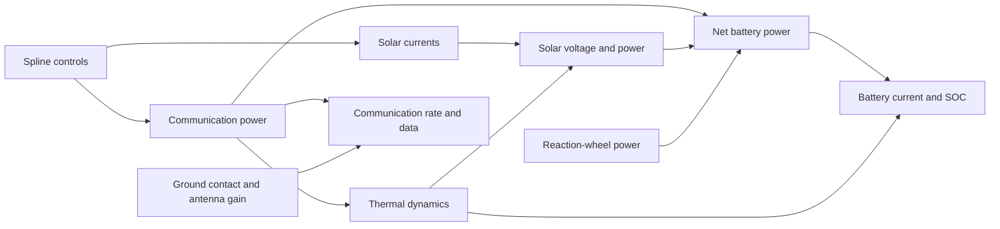

# Joint CADRE optimization

The joint model maximizes total downloaded data across six 12-hour cases.
Each case has communication-power controls, twelve solar-current profiles,
roll controls, and initial SOC. The cases share 84 surface allocations,
one fin angle, and one antenna angle.

At 1,500 nodes and 300 controls per profile there are 25,292 design variables.
Trajectory states and multipliers are additional. The reference is pinned
[OpenMDAO/CADRE](cadre_source.md). Our dynamics use trapezoidal integration and
battery bounds at each node; upstream uses RK4 and KS-aggregated constraints.

## Coupled model



Communication power is bounded to 0–25 W and solar-current controls to 0–0.4 A.
Battery SOC stays between 0.2 and 1.0, current between −10 and 5 A, and final
SOC equals initial SOC in each case.

## Saved results

| Result | Grid | Status |
| --- | --- | --- |
| `single_case_600` | Case 0, 600 nodes, 120 controls, 12 hours | Fresh converged run; 126 iterations, 2,366.77 solver seconds |
| `joint_case0_full_600` | Case 0, 600 nodes, 120 controls, 12 hours | Converged and independently validated |
| `joint_case0_prefix_600` | Case 0, 600 nodes, 120 controls, 4.795 hours | Converged; independent sparse solve agrees |
| `joint_300` | Six cases, 300 nodes, 60 controls, 12 hours | Converged and independently validated; final warm-start segment has 19 iterations |
| `joint_300/candidate_600` | Six cases, 600 nodes, 120 controls, 12 hours | Feasible checkpoint; not converged |
| `joint_300/reference_start_1500` | Six cases, 1,500 nodes, 120 controls, 12 hours | Reference battery checks pass; native check and optimization not run |
| `joint_start_600` | Six cases, 600 nodes, 120 controls, 12 hours | Feasible starting point; not optimized |
| `joint_case0_start_1500` | Case 0, 1,500 nodes, 300 controls, 12 hours | Feasible starting point; not optimized |

The [fresh single-case run](single_case_600.md) downloads 4,605.910122 units,
with NLP error 1.000e-9 and all validation checks passed. It starts without a
checkpoint and takes 126 iterations / 2,366.77 solver seconds.

The earlier full-duration single-case result has 1,767 design variables, downloaded data
4,605.758184, NLP error 2.866e-9, and native primal residual 4.288e-10. Its
reconstructed feasible baseline is 3,299.079088, a 39.6074% improvement on that
same grid. `continuation.json` retains the baseline audit and preceding run
segments. The final restart took 17 iterations and 220.51 seconds; this is not
a cold-run timing.

Holding its 120 controls fixed and replaying at 1,500 nodes gives 4,622.610150
data units, but current reaches −10.086123 A against the −10 A limit. SOC and
periodicity also fail. The saved `mesh_replay.json` records this check. Refitting
to 300 controls and repairing power and initial SOC gives the feasible
`joint_case0_start_1500` point: data 4,603.227195 and native error 1.596e-12.
These checks do not establish fine-grid optimality or mesh convergence.

The six-case `joint_300` result has converged and passed independent validation.
It has 5,132 design variables and downloads 17,138.658661 units. Final NLP error
is 8.726e-9, native primal residual 8.726e-9, and dual residual 4.435e-9.
Variable bounds, battery limits, and SOC periodicity pass in all six cases.
The reference is infeasible, so no percentage gain is reported.

The final full-space segment took 19 iterations and 509.75 seconds. This is
not a cold-run time: an earlier centered projected phase prepared the starting
point. Continuing from its barrier-0.01 checkpoint with the multipliers retained
allowed the ordinary full-space method to converge. The projected phase alone
and the regularization-fallback trial did not establish convergence.
`continuation.json` preserves this history and the earlier candidate's summary
and iterations. The old candidate's files are archived outside the repository.

A fixed-control replay at 600 nodes gives 15,803.085184 units (−7.7928%), with
SOC or periodicity violations in every case. The largest SOC bound violation
is 0.002403 and the largest endpoint error is 0.004031. This is an independent
reference replay, not a native fine-grid solve. Its report and comparison plot
are saved as `mesh_replay_600` in the result folder.

The derived `joint_300/refined_start_600` point uses 600 nodes, 120 controls,
and 10,172 design variables. Refitting and repairing power/initial SOC gives
15,762.256739 data units, native error 4.485e-12, and zero bound violation.
Independent replay and battery checks pass, and its checkpoint loads correctly.
This is a feasible start, not an optimization result.

A separate `joint_300/interior_start_600` point leaves battery and power-control
margins for the solver. SOC lies between 0.215 and 0.985, and power controls
stay at least 0.001 W inside their 0–25 W bounds. Native equations, independent
replay, current limits, periodicity, and checkpoint loading pass. Native error
is 4.485e-12 and data totals 15,349.629783 units. Its six power-profile and
initial-SOC repairs took 114.14 seconds total, excluding setup, refitting,
compilation, and final checks. The higher-data minimal repair above is preserved
separately. Neither repaired start is an optimized result.

The [600-node candidate](../results/joint_300/candidate_600/summary.json)
downloads 24,878.542032 units, 57.8362% more than `refined_start_600` on the
same grid. Its native equation error is 4.581e-12; bound, battery, and
periodicity checks pass. The NLP error is 2.153e3, so it is feasible but not
converged. The reference replay is also used to construct projected iterates,
so its exact agreement is expected; the compiled native equation check is a
separate cross-check. Its [overview](../results/joint_300/candidate_600/candidate_overview.png)
shows all six cases. The checkpoint is local and ignored by Git.

A fixed-control reference replay at 1,500 nodes gives 25,021.423720 units,
a +0.5743% change. All six cases fail periodicity; two violate SOC bounds
and two violate current limits. The largest SOC violation is 0.000267, current
violation 0.021827 A, and periodicity error 0.000509. See the
[grid check](../results/joint_300/candidate_600/mesh_replay_1500.png).
This holds 120 controls fixed; it is not a fine-grid optimization or a native
1,500-node model check.

The [reference repair](../results/joint_300/reference_start_1500/summary.json)
changes only communication-power controls to meet battery bounds and periodicity
on the 1,500-node grid. The largest control-point change is 0.022820 W; all six
cases pass the reference battery checks. Saved controls reproduce 25,013.758615
data units. This uses 120 controls and has no compiled native check or optimization.
The [figure](../results/joint_300/reference_start_1500/reference_start_overview.png)
shows its trajectories. The repaired point is not the full 300-control result.

The saved controls reconstruct the same 600-node candidate and pass the native
and battery checks without loading its checkpoint. To repeat that check:

```sh
pixi run --manifest-path ../amigo/pixi.toml python -m integrated.validation.mesh \
  integrated/results/joint_300/candidate_600 --nodes 600 --control-points 120 \
  --output /tmp/cadre-candidate-replay
```

This is a replay on the same grid, with no optimization. It does not establish
fine-grid feasibility.

The 600-node optimization remains unfinished. A previous battery-interior
start left some power controls only 2.5e-9 W above zero. At barrier 0.001,
centering their multipliers gave values near 400,000. Nine full steps barely
moved those controls, so that trial was stopped. The revised preparation keeps
the 0.001 W power margin during repair; the optimization still uses its original
0–25 W bounds. The diagonal trial used this revised point with symmetric
step limits and two case workers. After adjoint initialization, its dual
residual was 3.593e3 versus 3.933e5 for the previous start; the largest initial
KKT entry fell from 1.6e14 to 6.25e9. The diagonal trial reached an equality
residual of 9.61e-10 at iteration 16, but stationarity remained high.

A spectral full-space continuation retained the best checkpoint's primal and
dual variables. Its first corrected KKT solve had relative residual 1.865e-12,
but the step penalty reached 2.933e20 and progress remained slow. That trial
was stopped without convergence.

Projected preparation keeps the six trajectories feasible while adjusting
controls and shared geometry. It reduced the dual residual from 4.547e3 to
1.581e3, with native equality error 4.325e-12. This is not convergence.

A captured subproblem showed why some steps fell back to heavy damping:
the fixed 2,000-change active-set budget stopped a growing working set. The
trace had 1,937 additions, 63 releases, and no repeated working sets. Replaying
the same inverse responses finished in 2,331 iterations with 1,656 active
bounds. The joint solver now allows at least 2,000 working-set changes and
two per independent reduced design variable. Full corrected KKT residual,
curvature, step bounds, and original NLP convergence checks remain unchanged.

The latest projected segment was stopped after its dual residual rose to
6.334e10 and accepted steps became very small. Its best saved point was at
iteration 6, with dual residual 1.578e3 and native equality error 4.572e-12.
The local monitor was stopped with it; no automatic continuation is running.
The checkpoints and log remain in `/tmp/cadre-six-centered-box-gapfix-600`.
A stationarity check found that several communication-power controls in case 4
fell to about 1.6e-14 W. At the fixed barrier of 0.001, resetting a lower-bound
multiplier to barrier divided by its gap makes that multiplier about 6.33e10.
This explains the large dual residual; a reliable step or multiplier strategy
still needs to be tested before continuing this approach.

The gap checks now scale their floating-point tolerance to the gap instead of
using an absolute tolerance that could mask tiny gaps. A repeated 600-node step
from the best checkpoint matched the earlier result: one case-4 power control
fell from 2.747e-6 to 5.549e-7 W, close to the permitted 20% of its previous
gap. Its dual residual rose from 1.578e3 to 6.95e3, and the duplicate test was
stopped. The tighter precision check prevents false acceptance near zero, but
it does not prevent repeated legitimate 20% reductions. Battery restoration
therefore needed a different power-correction strategy.

An experimental `--relative-power-repair` option scales each full-profile
power correction by its nearest bound gap at the previous accepted point.
Near-bound controls are consequently more expensive to change. In the first
600-node trial from the same checkpoint, the old repair moved a case-4 control
from 4.881e-6 W to 5.549e-7 W; the new repair left it at about 4.881e-6 W.
After backtracking, the accepted step had NLP error 493.4 and dual residual
1.560e3, compared with 2.14e3 and 6.95e3 using the old repair. The new point
passed the trajectory feasibility checks. This was one step, not convergence;
the experimental run and checkpoint are in `/tmp/cadre-relative-repair-600`.
A warm-start follow-up accepted one more step, reaching NLP error 483.618 and
dual residual 1.543e3, with a recorded native primal residual of 4.619e-12.
Its second bounded solve ran for several minutes, so the test was stopped with
the accepted checkpoint saved in `/tmp/cadre-relative-repair-followup-600`.
The stopped follow-up has not had a completed independent validation report.

A subsequent one-step continuation from that point used two BLAS threads. It
finished in 414.71 solver seconds with NLP error 476.091 and dual residual
1.517e3. Native equations, bounds, reference replay, and battery checks passed,
but the solver did not converge. That result remains in
`/tmp/cadre-relative-progress-600`.
The replay also projects trial trajectories, so the compiled native-equation
check provides a separate cross-check. The earlier 1,500-node replay and repair
are based on `candidate_600`, not this newer candidate. The active-bound solve
now prints its progress every 250 working-set changes. Its 1,032-change
subproblem took approximately 80 seconds in this trial; the remaining solver
time includes factorization, trajectory repairs, and line-search work. This is
not a controlled whole-solver comparison of thread counts.

A six-step ordinary full-space test from the newer feasible checkpoint took
213.31 solver seconds. It did not converge; its final NLP error was 470.2 and
its dual residual was 1.531e3. Native equalities, reference replay, and battery
checks failed at the final point. Its results are in `/tmp/cadre-fullspace-latest-600`;
the feasible projected checkpoint was preserved.

Projected replay now caches each case's reference geometry when roll and both
shared angles are exactly unchanged. Power, solar currents, initial SOC, and
surface allocation are still replayed on every trial. Small-model checks
compare all cached outputs with fresh replay after changing each input; changes
to roll or either angle invalidate the cache. A 600-node repeat of the same
step produced identical checkpoint arrays and passed the same feasibility
checks. Recorded battery-repair time was 257.09 seconds with caching versus
278.67 seconds before it; total solver times were 444.16 and 414.71 seconds.
The runs were not controlled benchmarks, and neither converged.

One further projected step from the earlier feasible point took 336.35 solver
seconds. It passed native equations, bounds, replay, and battery checks; NLP
error was 475.447 and dual residual 1.485e3, so it remains unconverged. Its
[summary](../results/joint_300/candidate_600_latest/summary.json) and
[plot](../results/joint_300/candidate_600_latest/candidate_overview.png) are
saved; the local checkpoint is ignored by Git. Its 1,500-node replay has not
been checked.
The eight-node compiled projection regression passes, including both trial and
battery-repair tiny-gap checks. An additional 30-node full-window interior
restoration test reached its iteration limit on case 0; it does not establish
that full-window restoration passes on that coarse grid.


A short full-space continuation from the best projected checkpoint took two
iterations in 98.28 solver seconds. It passed the feasibility checks, but its
NLP error was 144 and dual residual 3.257e3, so it did not converge. A further
five iterations took 230.11 solver seconds. The residual oscillated and ended
at NLP error 333.7 and dual residual 6.676e3; native equality and replay
checks failed at the final point. The logs and checkpoints are in
`/tmp/cadre-six-fullspace-best-600` and
`/tmp/cadre-six-fullspace-followup-600`. Neither run is a converged result.


Initialization also refines the combined state-adjoint equations when large
periodicity multipliers cause cancellation. The earlier failing seed passed
after refinement, without relaxing its accuracy threshold.

This establishes convergence only on the 300-node / 60-control grid. The
1,500-node six-case problem and mesh convergence remain unfinished. A separate
30-step fine-grid single-case trial failed validation and is not a result.

## Run commands

Run from the repository root through AMIGO's environment. To reproduce the
shorter validated all-variable case:

```sh
pixi run --manifest-path ../amigo/pixi.toml python -m integrated.cadre_joint \
  --optimize --cases 0 --nodes 600 --control-points 120 --time-grid prefix \
  --objective-scale 1 --initial-barrier 0.1 --initial-bound-push 1e-4 \
  --full-space-trials --linear-solver block --max-iterations 150 \
  --output /tmp/cadre-case0-prefix
```

For a full 12-hour cold single-case run, use `--time-grid full` and allow more
iterations. The saved full-duration result continued development checkpoints;
a fresh run is not guaranteed to reproduce its iteration count or local solution.

To compile the full six-case model without optimizing:

```sh
pixi run --manifest-path ../amigo/pixi.toml python -m integrated.cadre_joint \
  --build --time-grid full --output /scratch/cadre/joint-model
```

Optimization defaults to the full 12-hour window. Build-only commands default
to the shorter prefix window unless `--time-grid full` is supplied. A reduced
full-window grid samples the geometry across all 12 hours. Contact windows and
eclipse transitions still require fine-grid checks.

A short six-case development test from saved named controls:

```sh
pixi run --manifest-path ../amigo/pixi.toml python -m integrated.cadre_joint \
  --optimize --primal-barrier --spectral-curvature --box-qp \
  --nodes 300 --control-points 60 --time-grid full --objective-scale 1 \
  --initial-design integrated/results/joint_start_600 --refit-controls \
  --initial-barrier 0.01 --max-iterations 10 \
  --output /tmp/cadre-six-case-test
```

This is a development test, not an expected ten-iteration convergence result.
Use a separate output directory for each attempt. `--help` lists all options.

## Resume the converged six-case preparation

`joint_300/checkpoint_central.npz` is the barrier-0.01 point used for the
successful full-space continuation. It is included in the repository. Keep its
multipliers by omitting
`--reset-multipliers` and the projected-mode flags:

```sh
pixi run --manifest-path ../amigo/pixi.toml python -m integrated.cadre_joint \
  --optimize --cases 0 1 2 3 4 5 --full-space-trials \
  --nodes 300 --control-points 60 --time-grid full --objective-scale 1 \
  --warm-start integrated/results/joint_300/checkpoint_central.npz \
  --max-iterations 40 --output /tmp/cadre-six-fullspace-resume
```

This is a warm-start command, not a measured cold solve. The model signature
must match. Importing named controls without the checkpoint starts a different
initialization and need not reproduce the 19-iteration count.

## Initialization and checkpoints

The initial solar-current guess fits a maximum-power profile from the voltage
table, with near-zero currents during eclipse. If its battery repair fails,
initialization falls back to the reference current and power controls.
`--repair-start` adjusts power and initial SOC once, with interior battery
margins; `--primal-barrier` includes this repair on a cold start. Failed repairs
stop the run. A baseline is used for percentage gains only if it is feasible.

`--initial-design DIR` reads named controls from `trajectories.npz` or
`controls.npz`. It checks reference identity, shapes, bounds, and time window,
then recomputes states and multipliers. Add `--refit-controls` when changing
control counts; this also requires battery repair. A spline fit alone does not
establish physical feasibility.

`--warm-start FILE` instead restores a compatible full checkpoint. Case order,
grid, objective scale, source fingerprint, and vector shapes must match.
Checkpoint files are ignored by Git and must be transferred separately, except
for the included 300-node preparation checkpoint.
`checkpoint.npz` stores the latest point, bound multipliers, and barrier;
`best_checkpoint.npz` stores the point with the lowest recorded KKT error.
Writes use atomic replacement. Filter history and iteration counters restart,
so each segment's timing must be reported separately.

The default warm-start bound push is zero. A nonzero `--warm-start-push` can
disturb trajectory consistency. `--reset-multipliers` recenters bound duals
and rebuilds trajectory adjoints. `--initial-barrier` overrides the initial
barrier. `--reuse-build` requires a matching build signature; compile again
if the build has been removed or the model changed.

Prepare a repaired fine-grid start without optimizing:

```sh
pixi run --manifest-path ../amigo/pixi.toml python -m integrated.validation.mesh \
  integrated/results/joint_case0_full_600 --nodes 1500 --control-points 300 \
  --repair --output /tmp/cadre-case0-fine-start
```

Omit `--repair` to measure an uncorrected replay. Use a separate output directory
to preserve the source. A successful repair saves controls and a checkpoint,
with `validated_initialization: true` and `optimization_run: false`.
See [server preparation](server_preparation.md) for the fine-grid run command.

## Prepare the six-case interior start

This prepares and validates a starting point without optimizing. Interior
repair requires 0.015 SOC margin, 0.15 A current margin, and 0.001 W power-control
margin. These restrict preparation only; model bounds are unchanged:

```sh
pixi run --manifest-path ../amigo/pixi.toml python -m integrated.validation.mesh \
  integrated/results/joint_300 --nodes 600 --control-points 120 \
  --repair --interior-start --output /tmp/cadre-six-interior-start
```

The following full-space continuation is experimental; it has not established
600-node convergence. The checkpoint keeps its barrier of 0.001. No additional
bound push is applied, since pushing the states can disturb feasibility.

```sh
pixi run --manifest-path ../amigo/pixi.toml python -m integrated.cadre_joint \
  --optimize --full-space-trials --limit-control-steps \
  --nodes 600 --control-points 120 --time-grid full --objective-scale 1 \
  --warm-start /tmp/cadre-six-interior-start/checkpoint.npz \
  --reset-multipliers --case-workers 2 --max-iterations 150 \
  --output /tmp/cadre-six-interior-optimize
```

## Reproduce the 1,500-node reference repair

From the repository root, run:

```sh
pixi run --manifest-path ../amigo/pixi.toml python -m integrated.validation.reference_repair \
  integrated/results/joint_300/candidate_600 --nodes 1500 \
  --output /tmp/cadre-reference-repair-1500
```

Use an empty output directory. The repair adjusts communication power using
linear programs and checks battery limits in the reference replay. It holds the
other controls and initial SOC fixed; it does not compile the native model or
optimize the CADRE objective.

## Check the 1,500-node reference start

On the compute server, check the saved 120-control point with the compiled
model without optimizing:

```sh
pixi run --manifest-path ../amigo/pixi.toml python -m integrated.validation.mesh \
  integrated/results/joint_300/reference_start_1500 --nodes 1500 --control-points 120 \
  --output /tmp/cadre-1500-reference-check
```

To prepare the full 300-control grid, refit and repair on that grid. This is a
larger model and may take substantial memory and time:

```sh
pixi run --manifest-path ../amigo/pixi.toml python -m integrated.validation.mesh \
  integrated/results/joint_300/reference_start_1500 --nodes 1500 --control-points 300 \
  --repair --interior-start --output /tmp/cadre-1500-full-start
```

A successful result is a checked starting point, not a completed optimization.

## Solver methods

The default objective is `-0.001 * sum(final_data)`; the validated single-case
runs use `--objective-scale 1`. The iteration table's objective includes barrier
terms. Use `total_downloaded_data` from independent replay for actual data.
Residuals must be interpreted with the selected objective scale.

The default block solver eliminates each case's trajectory and local controls,
then combines the 86 shared variables. One communication-power control per case
closes the energy balance. It checks local and shared reduced curvature and adds
scaled diagonal regularization when necessary. It also limits roll, initial SOC,
allocation, and angle directions to 10% of their bound ranges. The solver
refactors the corrected KKT equations rather than clipping the direction.

Every accepted linear solve is checked against the complete corrected KKT
system, with up to eight refinement steps. Near convergence, the diagonal modes
can recover an original Newton step through GMRES, provided its residual,
curvature, and step bounds pass. Nonlinear convergence uses the original NLP.
`--linear-solver sparse` provides an independent one-case reference;
`--linear-solver native` retains the native LDL diagnostic path.

By default, trial states are replayed from candidate controls. Strict-bound
violations are rejected. `--restore-periodicity` adds a bounded scalar power
correction, retaining proposed initial SOC. Recovered trajectory adjoints must
pass a fresh native gradient check. Rejected filter steps are rolled back.
`--full-space-trials` uses the ordinary full-space line search instead; both
validated all-variable single-case results use it.

The following options are experimental; none has established six-case convergence:

- `--limit-control-steps`: requires full-space trials and the block solver.
  It limits every finitely bounded state and control in both directions to 80%
  of its nearest bound gap, at most 10% of its range; roll changes are capped at
  0.05 radians. Corrections are included in the complete KKT solve. Tests using
  AMIGO's bound-dual update verify that at least half a step preserves positive
  bound multipliers, including after a barrier decrease. Nonlinear line-search
  acceptance still needs to be checked during optimization.
- `--primal-barrier`: replay and repair every trial to periodicity tolerance
  1e-12, center bound multipliers at barrier/gap, and limit every bounded state
  and control. Limits use 80% of the current bound gap, at most 10% of the full
  range, with roll changes capped at 0.05 radians. Restrictive eliminated states
  receive direct regularization. Centered complementarity is not convergence.
- `--spectral-curvature`: reflect negative eigenvalues of scaled case blocks
  and correct the shared Schur complement, preserving positive eigenmodes.
  Dense corrections remain within case blocks and are included in full KKT
  checks. Original-Newton recovery is disabled for this mode.
- `--box-qp`: requires `--primal-barrier`. An active-bound quadratic subproblem
  identifies restrictive bounds; nonnegative diagonal corrections are then
  applied through a fresh complete KKT solve. Cached responses and Cholesky
  updates avoid a global inverse. In projected mode, periodicity-price refits
  are accepted only when native stationarity improves. If scalar battery repair fails,
  individual power controls may change while all other proposed designs stay
  fixed; this repair retains at least 20% of the previous bound gaps.
  When linearized equalities have nonzero defects, the active set starts
  from a state-equation solve with independent design steps held at zero. If that particular step is outside its box, or the active-set iteration
  limit is reached, the solver uses the existing diagonal regularization method.
  A particular step outside its box does not imply the NLP is infeasible.
  The full KKT residual and step-bound checks still apply. Other numerical failures stop the
  run. `box_qp_fallbacks` counts both fallback conditions in a completed segment.
- `--relative-power-repair`: requires `--box-qp`. Scale full-profile battery
  corrections by each control's nearest gap to its previous bound. This is an
  experimental trial-repair metric; it does not change the original objective,
  constraints, or convergence checks.
- `--case-workers N`: factor independent case blocks concurrently. The default
  is one. Set BLAS thread counts to one before testing several workers.

A full-space active-bound experiment passed the compiled linear-system and
bound-dual checks but stopped before its third accepted step. The second step
left an equality defect of 0.248, and the next correction could not fit the
optional step limits. That command combination remains disabled. Its logs and
checkpoints are local in `/tmp/cadre-six-fullspace-box-affine-600`. The affine
starting-step correction and regression checks are retained in the backend.

These adapters live in this repository. AMIGO source is unchanged.

## Reports and numerical checks

New checkpoints also record NLP error, complementarity, and
`linear_solver_diagnostics`: curvature damping, step damping, linear residual,
step ratio, and active-bound counters. Older checkpoints remain readable.
These fields describe this segment; counters restart with the solver.

Future initial battery repairs print each case before and after repair, including
its elapsed time. Completed summaries record `initial_battery_repair_time_s`
and `projected_battery_repair_time_s`. These measure the joint repair callbacks;
they do not include separate reference-baseline preparation. Projected repair
time includes warm-start correction and line-search repairs.

Each completed attempt saves a summary, iteration history, trajectories,
shared-design plot, convergence plot, and a trajectory plot per case. Failed
validation saves diagnostics and raises. `feasibility_validated` means the
physical checks passed; `validated` also requires solver convergence.

The first active-set iteration-limit hit also saves
`step_bounds_diagnostic.npz`, containing its bounds, working-set trace, and
reduced inverse factors. The file can be large and is ignored by Git. It is
written atomically and does not replace a result or checkpoint. Replay it
without preparing or compiling the satellite model:

```sh
pixi run --manifest-path ../amigo/pixi.toml python -m integrated.validation.joint_solver \
  --replay /tmp/cadre-six-box-diagnostic-600/step_bounds_diagnostic.npz \
  --max-qp-iterations 6000
```

This reports subproblem convergence only, with `optimization_run: false`.
An unfinished subproblem returns a nonzero exit code. Omit `--replay` to run
the usual direct-solve and numerical checks.

Replot without optimizing:

```sh
pixi run --manifest-path ../amigo/pixi.toml python -m integrated.reporting.joint_plots \
  integrated/results/joint_300
```

Run the checks with `python -m integrated.validation.NAME` in the same environment:

| Check | Purpose |
| --- | --- |
| `joint_grid` | Sampling, command defaults, bounded control transfer |
| `joint_solver` | Direct-solve comparisons, inertia, curvature, affine active-bound QP |
| `joint_model` | Compiled derivatives, shared aliases, complete KKT solves |
| `initialization` | Six-case starting guesses and fallback behavior |
| `projection` | Native equations, battery repair, adjoints, filter rollback |
| `checkpoint` | Compatibility checks and multiplier loading |

Saved measurements are in `results/validation/`. Short contact-free checks
verify assembly, not optimization performance. See the
[saved results](../results/README.md) for figures and measurements.
