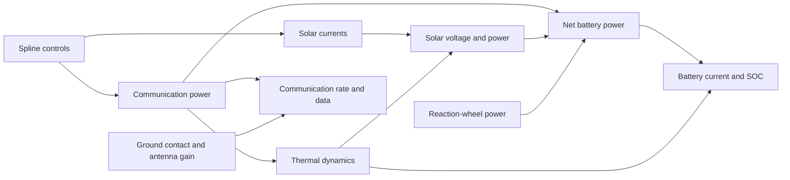

# Joint CADRE optimization

The joint model maximizes total downloaded data across six 12-hour cases.
Each case has communication-power controls, twelve solar-current profiles,
roll controls, and initial SOC. The cases share 84 surface allocations,
one fin angle, and one antenna angle.

At 1,500 nodes and 300 controls per profile there are 25,292 design variables.
Trajectory states and multipliers are additional. The reference is pinned
[OpenMDAO/CADRE](cadre_source.md). Our dynamics use trapezoidal integration and
battery bounds at each node; upstream uses RK4 and KS-aggregated constraints.

## Coupled model



Communication power is bounded to 0–25 W and solar-current controls to 0–0.4 A.
Battery SOC stays between 0.2 and 1.0, current between −10 and 5 A, and final
SOC equals initial SOC in each case.

## Saved results

| Result | Grid | Status |
| --- | --- | --- |
| `single_case_600` | Case 0, 600 nodes, 120 controls, 12 hours | Fresh converged run; 126 iterations, 2,366.77 solver seconds |
| `joint_case0_full_600` | Case 0, 600 nodes, 120 controls, 12 hours | Converged and independently validated |
| `joint_case0_prefix_600` | Case 0, 600 nodes, 120 controls, 4.795 hours | Converged; independent sparse solve agrees |
| `joint_300` | Six cases, 300 nodes, 60 controls, 12 hours | Feasible candidate; not converged |
| `joint_start_600` | Six cases, 600 nodes, 120 controls, 12 hours | Feasible starting point; not optimized |
| `joint_case0_start_1500` | Case 0, 1,500 nodes, 300 controls, 12 hours | Feasible starting point; not optimized |

The [fresh single-case run](single_case_600.md) downloads 4,605.910122 units,
with NLP error 1.000e-9 and all validation checks passed. It starts without a
checkpoint and takes 126 iterations / 2,366.77 solver seconds.

The earlier full-duration single-case result has 1,767 design variables, downloaded data
4,605.758184, NLP error 2.866e-9, and native primal residual 4.288e-10. Its
reconstructed feasible baseline is 3,299.079088, a 39.6074% improvement on that
same grid. `continuation.json` retains the baseline audit and preceding run
segments. The final restart took 17 iterations and 220.51 seconds; this is not
a cold-run timing.

Holding its 120 controls fixed and replaying at 1,500 nodes gives 4,622.610150
data units, but current reaches −10.086123 A against the −10 A limit. SOC and
periodicity also fail. The saved `mesh_replay.json` records this check. Refitting
to 300 controls and repairing power and initial SOC gives the feasible
`joint_case0_start_1500` point: data 4,603.227195 and native error 1.596e-12.
These checks do not establish fine-grid optimality or mesh convergence.

The six-case `joint_300` candidate downloads 17,099.976926 units, with native
error 4.183e-12 and no bound violation. Replay, battery limits, and periodicity
pass. Its 40-step continuation did not converge: NLP error is 69.02, raw dual
residual 1,227.03, and complementarity 0.01. The reference is infeasible, so no
percentage gain is reported. Its 3,385.80-second timing covers that segment only.
A further six-case continuation is running. A separate 30-step fine-grid
single-case trial failed convergence and physical validation; it does not
replace the saved validated results.

The older native-LDL roll/allocation trial and two early joint trials have
been removed. The current joint runner covers those design variables. Native
LDL remains available as a diagnostic solver, with checks in `validation/`.

## Run commands

Run from the repository root through AMIGO's environment. To reproduce the
shorter validated all-variable case:

```sh
pixi run --manifest-path ../amigo/pixi.toml python -m integrated.cadre_joint \
  --optimize --cases 0 --nodes 600 --control-points 120 --time-grid prefix \
  --objective-scale 1 --initial-barrier 0.1 --initial-bound-push 1e-4 \
  --full-space-trials --linear-solver block --max-iterations 150 \
  --output /tmp/cadre-case0-prefix
```

For a full 12-hour cold single-case run, use `--time-grid full` and allow more
iterations. The saved full-duration result continued development checkpoints;
a fresh run is not guaranteed to reproduce its iteration count or local solution.

To compile the full six-case model without optimizing:

```sh
pixi run --manifest-path ../amigo/pixi.toml python -m integrated.cadre_joint \
  --build --time-grid full --output /scratch/cadre/joint-model
```

Optimization defaults to the full 12-hour window. Build-only commands default
to the shorter prefix window unless `--time-grid full` is supplied. A reduced
full-window grid samples the geometry across all 12 hours. Contact windows and
eclipse transitions still require fine-grid checks.

A short six-case development test from saved named controls:

```sh
pixi run --manifest-path ../amigo/pixi.toml python -m integrated.cadre_joint \
  --optimize --primal-barrier --spectral-curvature --box-qp \
  --nodes 300 --control-points 60 --time-grid full --objective-scale 1 \
  --initial-design integrated/results/joint_start_600 --refit-controls \
  --initial-barrier 0.01 --max-iterations 10 \
  --output /tmp/cadre-six-case-test
```

This is a development test, not an expected ten-iteration convergence result.
Use a separate output directory for each attempt. `--help` lists all options.

## Initialization and checkpoints

The initial solar-current guess fits a maximum-power profile from the voltage
table, with near-zero currents during eclipse. If its battery repair fails,
initialization falls back to the reference current and power controls.
`--repair-start` adjusts power and initial SOC once, with interior battery
margins; `--primal-barrier` includes this repair on a cold start. Failed repairs
stop the run. A baseline is used for percentage gains only if it is feasible.

`--initial-design DIR` reads named controls from `trajectories.npz` or
`controls.npz`. It checks reference identity, shapes, bounds, and time window,
then recomputes states and multipliers. Add `--refit-controls` when changing
control counts; this also requires battery repair. A spline fit alone does not
establish physical feasibility.

`--warm-start FILE` instead restores a compatible full checkpoint. Case order,
grid, objective scale, source fingerprint, and vector shapes must match.
Checkpoint files are ignored by Git and must be transferred separately.
`checkpoint.npz` stores the latest point, bound multipliers, and barrier;
`best_checkpoint.npz` stores the point with the lowest recorded KKT error.
Writes use atomic replacement. Filter history and iteration counters restart,
so each segment's timing must be reported separately.

The default warm-start bound push is zero. A nonzero `--warm-start-push` can
disturb trajectory consistency. `--reset-multipliers` recenters bound duals
and rebuilds trajectory adjoints. `--initial-barrier` overrides the initial
barrier. `--reuse-build` requires a matching build signature; compile again
if the build has been removed or the model changed.

Prepare a repaired fine-grid start without optimizing:

```sh
pixi run --manifest-path ../amigo/pixi.toml python -m integrated.validation.mesh \
  integrated/results/joint_case0_full_600 --nodes 1500 --control-points 300 \
  --repair --output /tmp/cadre-case0-fine-start
```

Omit `--repair` to measure an uncorrected replay. Use a separate output directory
to preserve the source. A successful repair saves controls and a checkpoint,
with `validated_initialization: true` and `optimization_run: false`.
See [server preparation](server_preparation.md) for the fine-grid run command.

## Solver methods

The default objective is `-0.001 * sum(final_data)`; the validated single-case
runs use `--objective-scale 1`. The iteration table's objective includes barrier
terms. Use `total_downloaded_data` from independent replay for actual data.
Residuals must be interpreted with the selected objective scale.

The default block solver eliminates each case's trajectory and local controls,
then combines the 86 shared variables. One communication-power control per case
closes the energy balance. It checks local and shared reduced curvature and adds
scaled diagonal regularization when necessary. It also limits roll, initial SOC,
allocation, and angle directions to 10% of their bound ranges. The solver
refactors the corrected KKT equations rather than clipping the direction.

Every accepted linear solve is checked against the complete corrected KKT
system, with up to eight refinement steps. Near convergence, the diagonal modes
can recover an original Newton step through GMRES, provided its residual,
curvature, and step bounds pass. Nonlinear convergence uses the original NLP.
`--linear-solver sparse` provides an independent one-case reference;
`--linear-solver native` retains the native LDL diagnostic path.

By default, trial states are replayed from candidate controls. Strict-bound
violations are rejected. `--restore-periodicity` adds a bounded scalar power
correction, retaining proposed initial SOC. Recovered trajectory adjoints must
pass a fresh native gradient check. Rejected filter steps are rolled back.
`--full-space-trials` uses the ordinary full-space line search instead; both
validated all-variable single-case results use it.

The following options are experimental; none has established six-case convergence:

- `--primal-barrier`: replay and repair every trial to periodicity tolerance
  1e-12, center bound multipliers at barrier/gap, and limit every bounded state
  and control. Limits use 80% of the current bound gap, at most 10% of the full
  range, with roll changes capped at 0.05 radians. Restrictive eliminated states
  receive direct regularization. Centered complementarity is not convergence.
- `--spectral-curvature`: reflect negative eigenvalues of scaled case blocks
  and correct the shared Schur complement, preserving positive eigenmodes.
  Dense corrections remain within case blocks and are included in full KKT
  checks. Original-Newton recovery is disabled for this mode.
- `--box-qp`: requires primal-barrier mode. An active-bound quadratic subproblem
  identifies restrictive bounds; nonnegative diagonal corrections are then
  applied through a fresh complete KKT solve. Cached responses and Cholesky
  updates avoid a global inverse. Optional periodicity-price refits are accepted
  only when native stationarity improves. If scalar battery repair fails,
  individual power controls may change while all other proposed designs stay
  fixed; this repair retains at least 20% of the previous bound gaps.
- `--case-workers N`: factor independent case blocks concurrently. The default
  is one. Set BLAS thread counts to one before testing several workers.

These adapters live in this repository. AMIGO source is unchanged.

## Reports and numerical checks

Each completed attempt saves a summary, iteration history, trajectories,
shared-design plot, convergence plot, and a trajectory plot per case. Failed
validation saves diagnostics and raises. `feasibility_validated` means the
physical checks passed; `validated` also requires solver convergence.

Replot without optimizing:

```sh
pixi run --manifest-path ../amigo/pixi.toml python -m integrated.reporting.joint_plots \
  integrated/results/joint_300
```

Run the checks with `python -m integrated.validation.NAME` in the same environment:

| Check | Purpose |
| --- | --- |
| `joint_grid` | Sampling, command defaults, bounded control transfer |
| `joint_solver` | Direct-solve comparisons, inertia, curvature, active-bound QP |
| `joint_model` | Compiled derivatives, shared aliases, complete KKT solves |
| `initialization` | Six-case starting guesses and fallback behavior |
| `projection` | Native equations, battery repair, adjoints, filter rollback |
| `checkpoint` | Compatibility checks and multiplier loading |

Saved measurements are in `results/validation/`. Short contact-free checks
verify assembly, not optimization performance. See the
[meeting notes](meeting_result.md) for figures and results to present.
