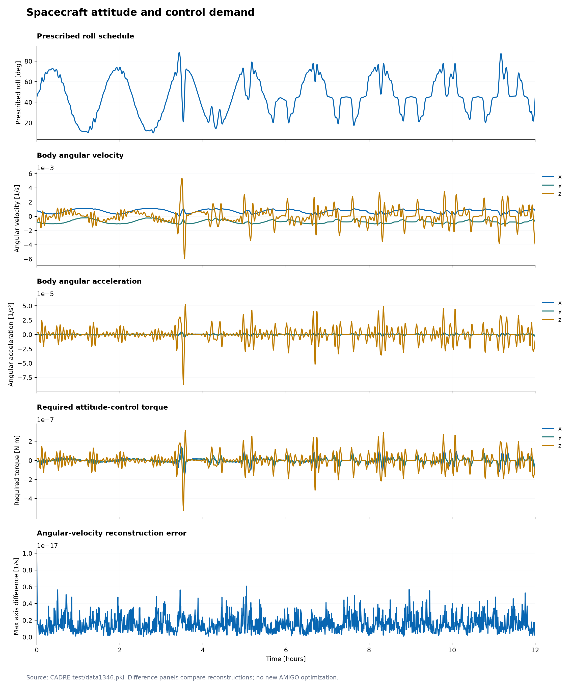
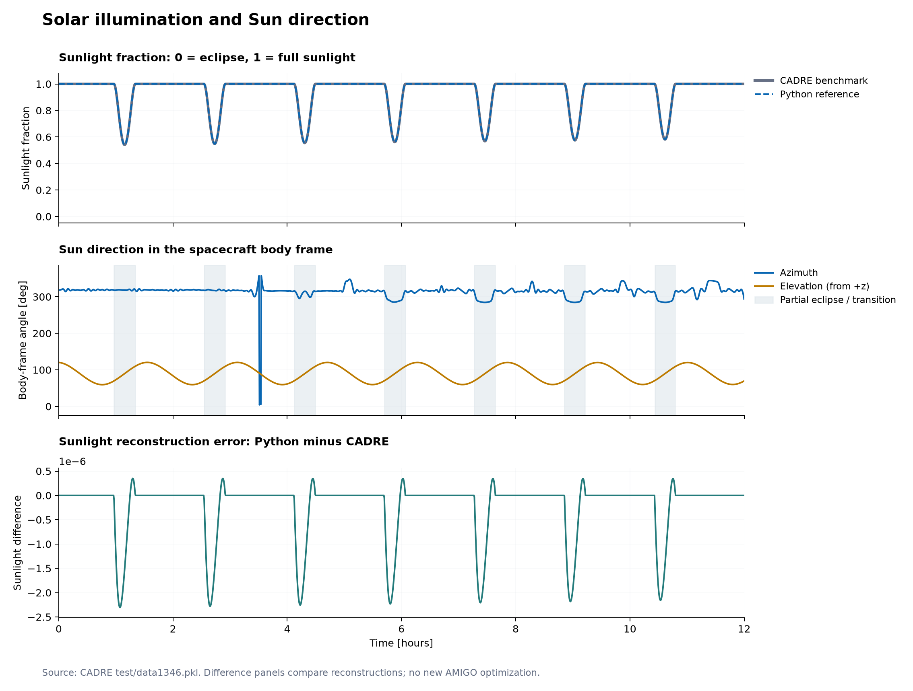
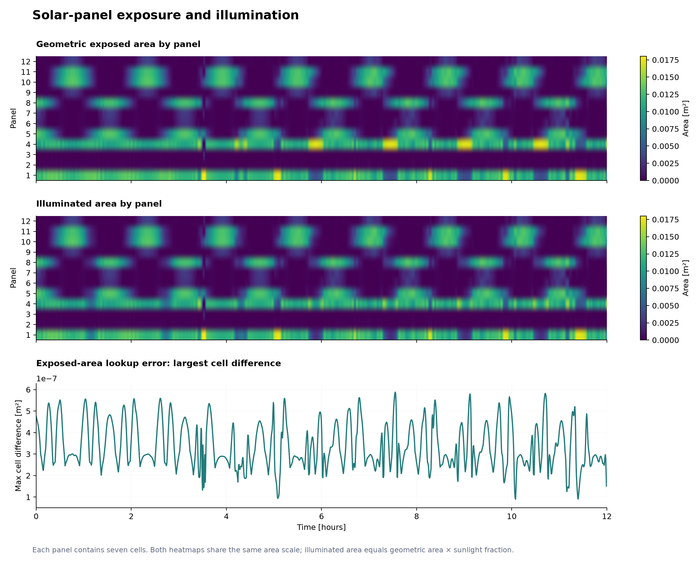
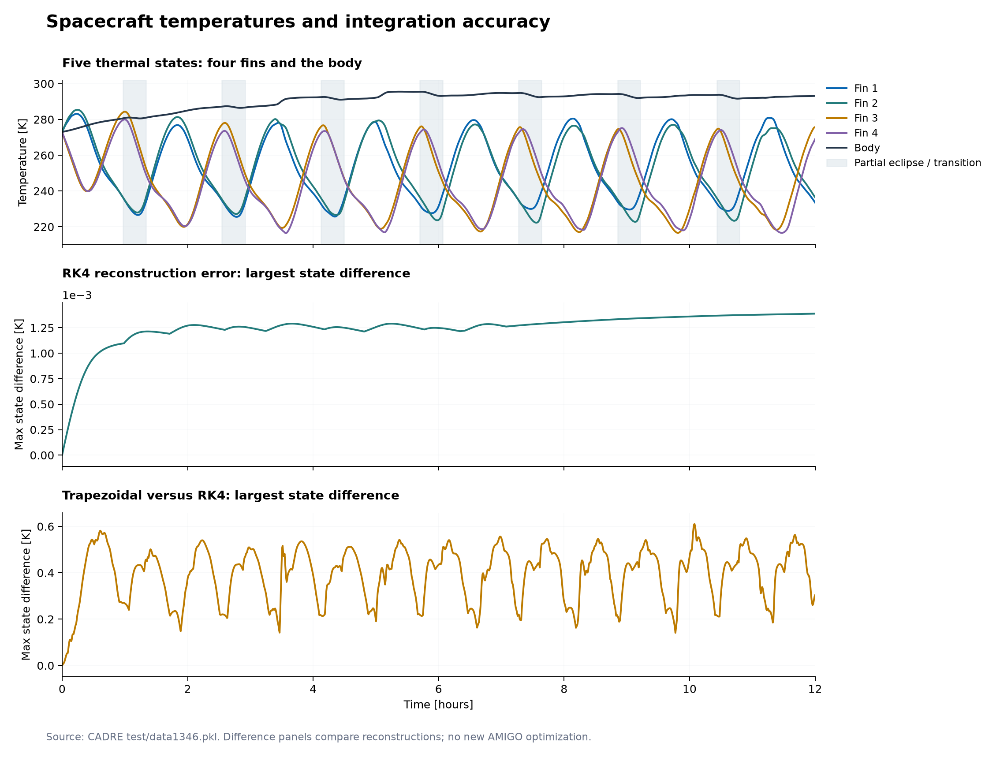
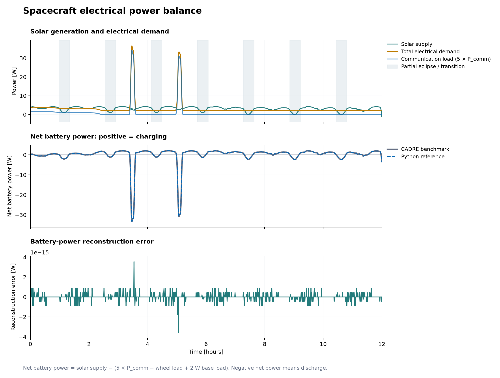
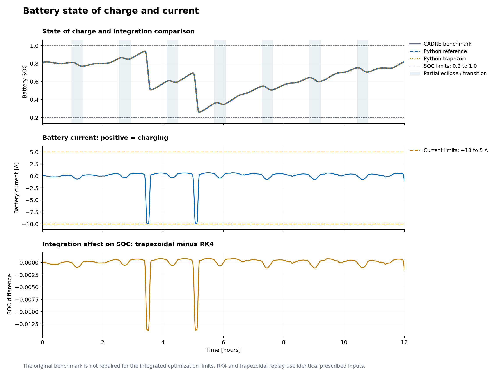
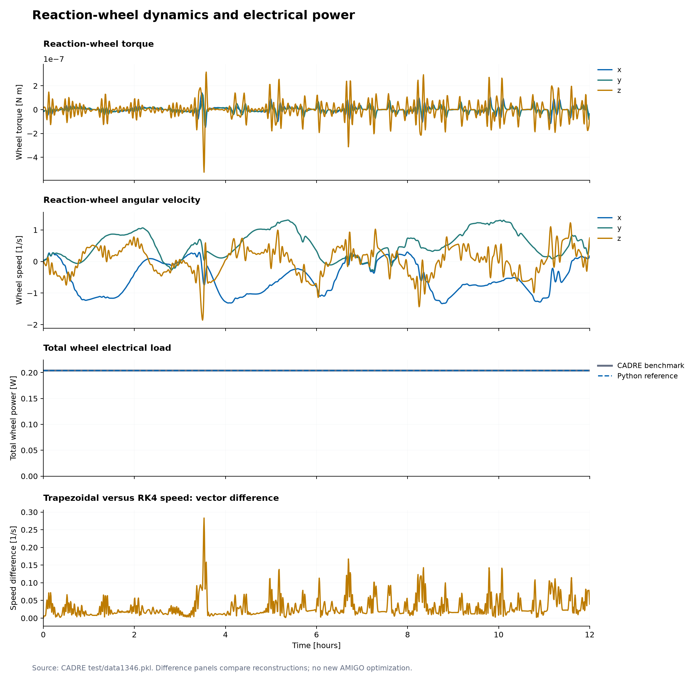
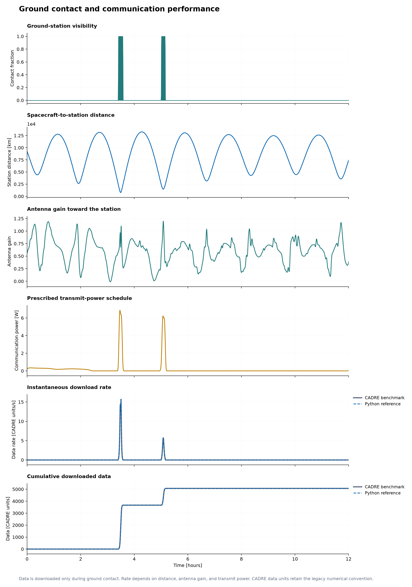
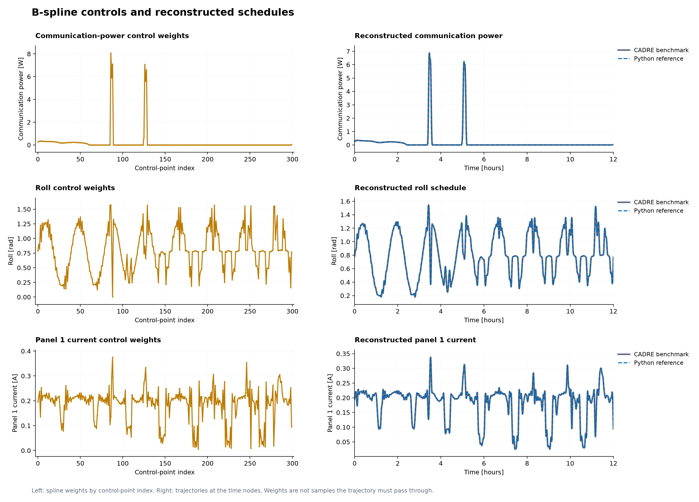

# CADRE subsystem visual guide

These plots use case 0 from the original 12-hour CADRE benchmark and the Python
reference functions in this repository. Generating them does not run AMIGO.

## Figure index

| Topic | Figures |
| --- | --- |
| Motion and control | [Orbit](figures/orbit.png), [attitude](figures/attitude.png), [reaction wheels](figures/reaction_wheel.png) |
| Environment | [Sunlight](figures/sun.png), [solar exposure](figures/solar.png), [temperature](figures/thermal.png) |
| Energy and data | [Power](figures/power.png), [battery](figures/battery.png), [communication](figures/communication.png) |
| Design controls | [B-spline weights and schedules](figures/parameters.png) |
| Integrated optimization | [Saved cases and figures](../integrated/results/README.md) |

All figures use [the shared style](style.py): a short title,
labeled panels, units on every quantitative axis, legends outside the data,
and a footer for conventions or important results. Time histories use hours.
Multi-panel current plots share their scales and legend. Heatmaps label every
panel and cell location, with the color scale shown alongside them.
Optimization figures also identify validation status.

Gray curves are saved CADRE outputs; dashed blue curves are Python
reconstructions. Gold comparison curves show the effect of switching from RK4
to trapezoidal integration. Error panels show differences that are too small to
see in the overlaid trajectories.

## Generate the figures

From the repository root:

```sh
pixi run --manifest-path ~/git/amigo/pixi.toml python -m visualizations
```

To generate only selected problems, or save figures somewhere else:

```sh
pixi run --manifest-path ~/git/amigo/pixi.toml python -m visualizations \
  --problem orbit thermal battery --output /tmp/cadre-figures
```

Set `CADRE_ROOT` if the external CADRE checkout is not at `../CADRE`.
Figures are saved without opening windows. `figures/measurements.json` records
the measured reference differences for the selected problems; generating a
selection replaces that file with measurements for the selection.
The standalone orbit, attitude, and Sun scripts use the same formatting and
still open their figures interactively. The orbit convergence study includes
both position and velocity differences.

## Orbit


The left panel shows the benchmark trajectory around a spherical Earth in
Earth-centered inertial coordinates. The right panels show altitude and the
position difference obtained by replaying the existing RK4 dynamics from the
benchmark's initial state.

Source: [orbit dynamics and RK4 propagation](../orbit/orbit_reference.py).

## Attitude



Prescribed roll changes the body's angular velocity, angular acceleration,
and required attitude torque.
The three component colors identify x, y, and z. The last panel compares the
reconstructed angular velocity with the saved benchmark.

Source: [attitude calculations](../attitude/attitude_reference.py).

## Sunlight and eclipse



Sunlight fraction is one in full sunlight and zero in eclipse. Solar angles are
measured in the spacecraft body frame; the model's elevation convention is the
angle from positive z. Shading marks illumination dips below full sunlight,
including transitions. This case has partial illumination dips rather than
full darkness.

Source: [Sun position and eclipse calculations](../sun/sun_reference.py).

## Solar exposure



Each heatmap row is one of the 12 panels, with the areas of its seven cells added
together. The first heatmap shows geometric exposure. The second multiplies that
area by sunlight fraction. Both heatmaps use the same color scale, so the loss
of illumination during partial eclipse is visible.

Source: [recreated solar MBI lookup](../solar/solar_mbi_validation.py).

## Temperature



Four fin temperatures and one body temperature respond to the heating/cooling
cycle. The error panels separately show RK4 reconstruction against CADRE and
trapezoidal integration against RK4, keeping the prescribed inputs identical.

Sources: [RK4 model](../thermal/thermal_reference.py),
[trapezoidal reference](../thermal/thermal_amigo.py).

## Power balance



Net battery power equals solar generation minus electrical loads. Communication
electrical consumption is five times the modeled communication-power variable;
wheel consumption and a 2 W base load are also included. Negative net battery
power means the battery supplies the shortfall. Inherited voltage-table outputs
are plotted without clamping, including any negative solar-power values.

Source: [solar and total power equations](../power/power_amigo.py).

## Battery



Battery current is positive during charging and negative during discharge.
The source benchmark has not been repaired for the integrated optimization's
current bounds, so it can cross the dashed limits. The lower panel shows how
changing the integration scheme changes SOC for the same prescribed inputs.

Source: [battery voltage, current, and SOC propagation](../battery/battery_reference.py).

## Reaction wheels



The required torque drives three wheel speeds, which determine electrical power.
The last panel isolates the speed difference between the two integration schemes.

Source: [reaction-wheel dynamics and power](../reaction_wheel/reaction_wheel_reference.py).

## Communication



The spacecraft can download data only during ground-station contact. Distance,
antenna gain, and communication power affect the rate during those windows.
Cumulative downloaded data grows in steps. The plots use CADRE data units;
the legacy bytes conversion has not been established.

Source: [bitrate and RK4 accumulation](../communication/communication_data_validation.py).

## Spline controls



The left column shows control weights by index; the right shows the smooth
trajectories at the time nodes. The weights are not samples that the curve must
pass through. Communication power, roll, and one panel-current profile illustrate
the same cubic B-spline mapping.

Source: [spline basis and parameter reconstruction](../parameters/parameters_reference.py).

For optimization results, see the
[integrated model guide](../integrated/README.md) and its saved trajectory and
convergence plots.
